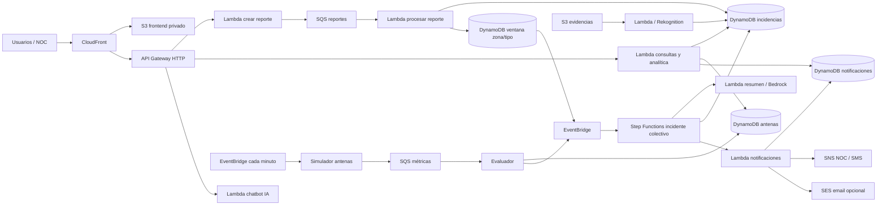

# Arquitectura actual — Red TeleCorp

## Flujos evaluables

1. **Telemetría proactiva:** 20 antenas generan GB/min cada minuto. El evaluador aplica exactamente `0 = INHABILITADA`, `0 < x < 60 = CAIDA`, `60 <= x <= 129 = NORMAL`, `x > 129 = SATURADA`. Todo cambio publica un evento; una caída alerta al NOC incluso sin reportes.
2. **Reporte resiliente:** la API valida y responde `202`; SQS absorbe el pico, reintenta por elemento y mueve fallos persistentes a DLQ. La clave de incidencia y evento inicial son idempotentes.
3. **Correlación:** la ventana usa `zona + tipo de problema + usuario`, por lo que diez reportes repetidos de una persona cuentan una vez y tipos no relacionados no se mezclan.
4. **Orquestación:** Step Functions resume con IA, usa fallback si falla, crea el incidente colectivo, notifica usuarios afectados y avisa al NOC.
5. **Histórico:** DynamoDB guarda META y eventos; `resolvedAt`/`closedAt` permiten calcular duración, y el endpoint analítico agrega zonas, tipos, usuarios y recurrencia de antenas.

## Disponibilidad, seguridad y límites

- DynamoDB on-demand y S3 son servicios regionales administrados; PITR está habilitado para información crítica.
- SQS desacopla la ingesta y sus DLQ conservan los mensajes no procesables.
- Los secretos se obtienen en tiempo de ejecución desde Secrets Manager.
- `MaximumConcurrency: 2` protege la cuota de Learner Lab; en producción se eleva según métricas de cola.
- El requisito Azure se declara como no implementado y no se incluye código externo sin despliegue verificable.
